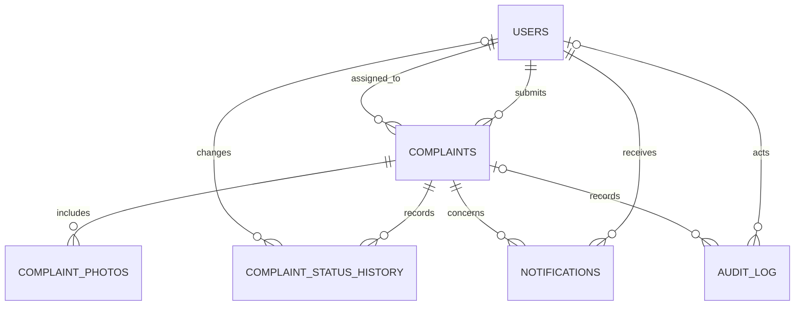

# CivicPulse Sylhet — Project Proposal and Technical Documentation

## 1. Project title

**CivicPulse Sylhet: Citizen Issue Reporting and City Service Coordination Portal**

## 2. Introduction

Residents often have no single, convenient place to report neighborhood problems, attach evidence, and follow the City Corporation's response. Staff, in turn, need a shared view of incoming requests and their status in order to assign work, coordinate departments, and communicate progress.

CivicPulse Sylhet is a web-based citizen reporting portal for Sylhet City Corporation (SCC). A citizen can create an account, report an issue with a category, ward, description, optional map pin and up to three photos, and follow its progress. SCC staff can review the inbox, acknowledge and update reports, assign departments or officers, set due dates, and send public updates. The project demonstrates a complete React/Express/MySQL application, authentication, relational data modeling, role-based access, and CRUD-style workflows.

## 3. Problem statement

- Citizens need a clear process for submitting and following up on local issues.
- Reports need consistent categories, wards, statuses, and supporting information.
- SCC staff need a centralized inbox rather than disconnected report records.
- Citizens need to know whether a report was received and what action is being taken.
- Staff-only notes and account operations must not be exposed to citizen or read-only demo accounts.

## 4. Objectives

1. Build a centralized portal connecting citizens with SCC service teams.
2. Allow authenticated citizens to submit and track their own reports.
3. Provide staff with a searchable, filterable operational dashboard.
4. Implement relational persistence and create/read/update/delete-style data operations using MySQL.
5. Enforce authorization so citizens can access only their own reports and only authorized SCC staff can modify report records.
6. Record report status history, staff actions, notifications, and uploaded-photo metadata.
7. Demonstrate a deployable full-stack application using Vercel, Render, and an external MySQL-compatible database.

## 5. Scope and user roles

### 5.1 Citizen

- Register and sign in.
- Submit an issue for an SCC ward with a category, description, priority, location choice, and up to three photos.
- View only their own reports, public responses, status history, and notifications.
- Confirm a report that SCC has marked resolved, or reopen a resolved report with a reason.
- Save an in-progress report draft in the browser. Selected photos are not stored in that draft.

### 5.2 SCC officer

- Sign in with an authorized staff account.
- Review the shared report inbox, overview metrics, map, trends, audit activity, and duplicate suggestions.
- Acknowledge submitted reports and edit report status, priority, department, due date, public response, and internal notes.
- Assign reports to an SCC officer where permitted.
- Apply a status to selected reports and export filtered report data as CSV.

### 5.3 Super administrator

- Perform officer functions.
- Create SCC officer and read-only viewer accounts.
- View the staff list and manage staff access through the provided account-creation workflow.

### 5.4 Read-only viewer

- Inspect the dashboard and report details without write privileges.
- Cannot acknowledge reports, edit fields, or view internal notes.
- The public production demo dashboard uses this read-only role. Editing requires signing in with an SCC staff account configured by the operator.

## 6. Main features

### 6.1 Citizen portal

- Account registration and login with a server-side session.
- Three seeded citizen demo accounts for exploration when demo logins are enabled.
- Structured issue category and Ward 1–27 selection.
- Interactive map pin or an explicit “prefer not to share” location option.
- Optional street/landmark description and priority selection.
- Upload up to three supported images. Images are validated and re-encoded as WebP before storage.
- Inline validation, submission progress, retry messaging for transient cold-start errors, and clear success/error feedback.
- On successful submission, reset the form and update the report list, notifications, and summary cards.
- Report history, public SCC responses, notifications, resolution confirmation, and reopening.

### 6.2 SCC operations dashboard

- Metrics for all reports, new reports, in-progress work, resolved reports, overdue work, and average resolution time.
- Map and charts for report distribution by category, day, and ward.
- Report inbox with search and status, priority, and ward filters.
- Detailed report panel with status timeline, citizen-provided content, photos, and location.
- Explicit **Accept / acknowledge report** action for submitted reports, followed by editable fields for authorized staff.
- Department/officer assignment, due date, public response, internal note, and status updates.
- Bulk status changes, CSV export, recent audit activity, and nearby duplicate candidates.
- Live dashboard refresh through server-sent events.

## 7. Technology stack and deployment

| Layer | Technology |
|---|---|
| Frontend | React 18, Vite, JavaScript, CSS, Leaflet / React Leaflet |
| API | Node.js, Express |
| Database | MySQL-compatible MariaDB/MySQL using `mysql2` |
| Authentication | `express-session`, HTTP-only cookie, custom MySQL session store |
| Image handling | Multer memory upload and Sharp image processing |
| Frontend tests | Vitest, jsdom, React Testing Library |
| Backend tests | Node.js built-in test runner |
| Frontend hosting | Vercel |
| API hosting | Render Free web service |
| Database hosting | External MySQL provider (Aiven in the demo deployment) |

The frontend calls same-origin `/api/*` routes. Vercel rewrites these requests to the Render API. Render connects to the external database using environment variables. Production database credentials and session secrets belong in the hosting provider's environment configuration, not in source control.

## 8. System architecture

```text
Citizen or SCC staff browser
             |
             | HTTPS, first-party session cookie
             v
       Vercel React app
             |
             | /api/* rewrite
             v
       Render Express API
        /            \
       /              \
 MySQL-compatible    Private image storage
 database            (deployment-dependent)
```

- `client/` contains the Vite/React application.
- `server/` contains the Express API, database bootstrap, session store, image service, and tests.
- `shared/sylhet.js` provides categories, wards, priorities, report statuses, departments, and map-area guidance shared between browser and API.
- `vercel.json` configures the frontend build and API rewrite.
- Database initialization creates missing tables and applies additive schema changes at API startup. Demo account and sample-report seeding is controlled by the deployment configuration and is idempotent.

## 9. Database design

The schema uses InnoDB and `utf8mb4`. The API creates the base tables and additively migrates columns and indexes. `BIGINT UNSIGNED` identifiers are used for primary and foreign keys. Timestamps are stored with millisecond precision where defined. The tables below describe the application's current logical schema; optional migration-added columns may be absent in an older database until startup completes.

### 9.1 Entity relationships



`SESSIONS` stores serialized session payloads and has no declared foreign key to `users`; the session payload contains the authenticated user ID.

### 9.2 Tables and important fields

#### `users`

| Column | Purpose |
|---|---|
| `id` | Auto-increment primary key. |
| `email` | Unique account email. |
| `name` | Display name. |
| `password_hash` | Bcrypt password hash; never returned by the API. |
| `role` | Authorization role: `citizen`, `scc_officer`, `super_admin`, or `viewer`. |
| `department` | Optional SCC department for staff. |
| `created_at` | Account creation timestamp. |
| `deleted_at` | Nullable soft-delete marker used by account lookups. |

#### `complaints` (citizen service reports)

| Column | Purpose |
|---|---|
| `id` | Auto-increment primary key. |
| `user_id` | Required citizen owner; references `users.id`. |
| `report_code` | Human-readable identifier, for example `SCC-2026-000001`; unique index. |
| `type` | SCC issue category. |
| `ward` | SCC ward, nullable for legacy reports. |
| `description` | Citizen's issue description. |
| `status` | Current workflow status. |
| `priority` | `normal`, `urgent`, or `safety_hazard`. |
| `latitude`, `longitude` | Optional map coordinates. |
| `location_text` | Optional address/landmark description. |
| `location_not_shared` | Whether the citizen selected the location privacy opt-out. |
| `public_response` | Update visible to the reporting citizen. |
| `internal_notes` | Staff-only notes. |
| `due_at` | Optional estimated due date. |
| `assigned_department` | Optional SCC department. |
| `assigned_to` | Optional staff user ID. |
| `resolution_reason`, `reopen_reason` | Resolution/reopen context when supplied. |
| `resolved_at`, `confirmed_resolved_at` | Resolution lifecycle timestamps. |
| `response_updated_at` | Last public-response timestamp. |
| `idempotency_key` | Per-user request key to prevent duplicate submissions on retry. |
| `demo_key` | Unique marker for idempotently seeded sample reports. |
| `created_at`, `updated_at` | Submission and last-update timestamps. |
| `deleted_at` | Nullable soft-delete marker. |

Important indexes support owner/date lookups, status, report code, ward/date, category/date, coordinates, demo-seed uniqueness, and per-user idempotency.

#### `complaint_status_history`

| Column | Purpose |
|---|---|
| `id` | Primary key. |
| `complaint_id` | Report whose status changed; cascades on report deletion. |
| `changed_by` | Nullable user who made the change; set to null if that account is deleted. |
| `from_status`, `to_status` | Previous and new status. |
| `public_note` | Optional update displayed to the citizen. |
| `internal_note` | Optional staff-only history note. |
| `created_at` | Change timestamp. |

#### `complaint_photos`

| Column | Purpose |
|---|---|
| `id` | Primary key. |
| `complaint_id` | Associated report; cascades on report deletion. |
| `file_name` | Unique server-side image name; file contents are stored by the image service. |
| `mime_type` | Processed image media type (normally WebP). |
| `file_size`, `width`, `height` | Processed image metadata. |
| `photo_kind` | Photo classification, defaulting to `before`. |
| `created_at` | Upload timestamp. |

#### `notifications`

| Column | Purpose |
|---|---|
| `id` | Primary key. |
| `user_id` | Recipient; cascades on account deletion. |
| `complaint_id` | Related report; cascades on report deletion. |
| `message` | Notification text. |
| `read_at` | Nullable timestamp indicating it has been read. |
| `created_at` | Creation timestamp. |

#### `audit_log`

| Column | Purpose |
|---|---|
| `id` | Primary key. |
| `actor_id` | Nullable actor; set to null if the user is deleted. |
| `complaint_id` | Nullable associated report; set to null if the report is deleted. |
| `action` | Event label such as report submission or resolution confirmation. |
| `details` | JSON details for the event. |
| `created_at` | Event timestamp. |

#### `sessions`

| Column | Purpose |
|---|---|
| `session_id` | Session identifier primary key. |
| `session_data` | Serialized server-side session payload. |
| `expires_at` | Expiration timestamp; an index supports expired-session cleanup. |

### 9.3 Status model

Statuses defined in the shared application model are `submitted`, `open`, `acknowledged`, `in_progress`, `resolved`, `confirmed_resolved`, `reopened`, and `rejected`.

Typical flow:

```text
Citizen submits
      |
      v
  Submitted -> Acknowledged -> In progress -> Resolved -> Citizen confirms -> Confirmed resolved
       ^                                                |
       |                                                +-- Citizen reopens with a reason
       +----------------------- Reopened <--------------+
```

The workflow permits authorized staff to update statuses through the API; only the reporting citizen may confirm a staff-marked resolution. A citizen can reopen a report only after it is marked resolved or confirmed resolved and must provide a reason.

## 10. CRUD logic demonstration

CRUD means Create, Read, Update, and Delete. In this application, deletes are generally represented as soft deletion for user/report records where a `deleted_at` column exists; ordinary citizen report submission does not include an unrestricted delete action. Foreign-key cascades are used for dependent records where defined.

### 10.1 Create

**Citizen registration**

1. Validate name, email, and password length in the API.
2. Normalize the email and reject an existing account.
3. Hash the password with bcrypt.
4. Insert a citizen record into `users`.
5. Regenerate the session ID and sign the user in.

**Report submission**

1. Validate category, description, ward, priority, and location/privacy choice.
2. Enforce a daily submission limit and check the per-user idempotency key.
3. Validate and process uploaded photos.
4. In a MySQL transaction, insert the `complaints` record, report code, initial `complaint_status_history` entry, photo metadata, and audit entry.
5. Commit and publish a live `report.created` event.

Representative SQL (simplified from the API):

```sql
INSERT INTO complaints
  (user_id, type, ward, description, status, priority,
   latitude, longitude, location_text, location_not_shared,
   idempotency_key, created_at, updated_at)
VALUES (?, ?, ?, ?, 'submitted', ?, ?, ?, ?, ?, ?, ?, ?);

INSERT INTO complaint_status_history
  (complaint_id, changed_by, from_status, to_status, created_at)
VALUES (?, ?, NULL, 'submitted', ?);
```

### 10.2 Read

- Citizens can list reports with `GET /api/complaints`; the API scopes the query to the authenticated `user_id`.
- Staff can list/filter reports with `GET /api/admin/reports`.
- Authorized staff can read a report detail with `GET /api/admin/reports/:id`.
- Role-specific projections omit internal notes from viewer/citizen responses.
- Report-photo endpoints verify that the requesting user owns the report or is authorized SCC staff.

Representative SQL (simplified):

```sql
SELECT c.*
FROM complaints AS c
WHERE c.user_id = ?
  AND c.deleted_at IS NULL
ORDER BY c.created_at DESC
LIMIT ? OFFSET ?;
```

### 10.3 Update

- SCC officers and super admins update report fields through `PATCH /api/admin/reports/:id`.
- Status updates are recorded in the complaint history and audit log; relevant users can receive notifications.
- A citizen can update lifecycle status only through the specific confirm-resolution and reopen actions.
- Notification read state is changed through `PATCH /api/complaints/notifications/:id/read`.

Representative staff update (simplified):

```sql
UPDATE complaints
SET status = ?, priority = ?, assigned_department = ?,
    public_response = ?, due_at = ?, updated_at = ?
WHERE id = ?
  AND deleted_at IS NULL;
```

The API validates allowed fields and values and performs report updates in a transaction. Staff-only writes are protected by server-side role middleware; hiding or disabling a browser control alone is not the security boundary.

### 10.4 Delete / deactivation

- User and complaint schemas include nullable `deleted_at` markers to support soft-delete filtering.
- The application does not expose a general citizen report deletion control.
- The current documented admin UI provides staff creation and report management; destructive account-management operations must be explicitly authorized and audited if added.
- Database foreign-key behavior removes dependent photo metadata, status history, or notifications only where the declared relationship specifies `ON DELETE CASCADE`. Physical deletion should not be substituted for soft deletion without reviewing audit/retention requirements.

## 11. API surface

All routes are under `/api`.

| Route | Access | Purpose |
|---|---|---|
| `GET /health` | Public | Health/readiness check for the API and database. |
| `POST /auth/register` | Public | Register a citizen account. |
| `POST /auth/login` | Public | Sign in and establish a session. |
| `GET /auth/me` | Authenticated | Return the current user's safe profile. |
| `POST /auth/logout` | Authenticated/session | Destroy the current session. |
| `POST /complaints` | Citizen | Submit a report with optional multipart photos. |
| `GET /complaints` | Citizen | List the current citizen's reports. |
| `GET /complaints/:id` | Owner | Read one of the current citizen's reports. |
| `POST /complaints/:id/confirm-resolution` | Owner | Confirm an SCC resolution. |
| `POST /complaints/:id/reopen` | Owner | Reopen an eligible resolved report with a reason. |
| `GET /admin/overview` | SCC staff/viewer | Read dashboard metrics. |
| `GET /admin/reports` | SCC staff/viewer | Search and filter the report inbox. |
| `GET /admin/reports/:id` | SCC staff/viewer | Read report details. |
| `PATCH /admin/reports/:id` | Officer/super admin | Update report workflow and response fields. |
| `PATCH /admin/reports/bulk/status` | Officer/super admin | Change status for selected reports. |
| `GET /admin/staff`, `POST /admin/staff` | Super admin | List and create staff accounts. |
| `GET /admin/audit-log` | SCC staff/viewer | Review recent audit activity. |
| `GET /admin/duplicate-candidates` | SCC staff/viewer | View possible nearby duplicates. |
| `GET /admin/events` | SCC staff/viewer | Subscribe to live report changes. |

## 12. UI mock-ups

These text wireframes describe the implemented page hierarchy; they are documentation mock-ups, not production HTML or a design-system specification.

### 12.1 Citizen sign-in

```text
+--------------------------------------+--------------------------------------+
| CivicPulse Sylhet                    | CITIZEN PORTAL                       |
|                                      | Welcome back                         |
| Better streets start                | [ Email address                  ]   |
| with being heard.                   | [ Password                       ]   |
|                                      | [ Sign in                         -> ]|
|                                      | New to CivicPulse? Create an account |
|                                      | Demo citizen accounts                |
+--------------------------------------+--------------------------------------+
```

### 12.2 Citizen dashboard

```text
+--------------------------------------------------------------------------+
| CivicPulse Sylhet             Notifications          Citizen  [Sign out] |
| Good to see you, [name].                                                 |
| [Total reports]       [In progress]       [Resolved]                     |
|                                                                          |
| REPORT AN ISSUE                         MY REPORTS                        |
| [Issue category v]                     [Report code] [Status]             |
| [Ward / Area     v]                     [Category, ward, description]     |
| [Priority        v]                     [Public SCC update / history]      |
| [Interactive map / current pin]                                          |
| [ ] Prefer not to share location                                          |
| [Location details____________]                                            |
| [Photos (up to 3)             ]                                           |
| [Describe the issue________________________]                              |
| [Submit report]                                                           |
+--------------------------------------------------------------------------+
```

### 12.3 SCC operations dashboard

```text
+--------------------------------------------------------------------------+
| CivicPulse Sylhet       SCC Officer · Roads                 [Sign out]    |
| Operations dashboard                         [Citizen portal]             |
| [All] [New today] [Awaiting action] [In progress] [Resolved] [Overdue]    |
|                                                                          |
| REPORT MAP                                                               |
| [Map with approximate report markers]                                    |
|                                                                          |
| REPORT INBOX       [Search reports] [Status v] [Priority v] [Ward v]      |
| Report          Category / ward     Status       Priority    Department   |
| SCC-...         Roads · Ward 10     Submitted    urgent      Unassigned  |
| SCC-...         Water · Ward 1      In progress   normal      Water team  |
+--------------------------------------------------------------------------+
```

### 12.4 Admin report detail

```text
+---------------------------------- REPORT DETAIL -------------------------+
| SCC-YYYY-000001                                             [Close]      |
| Category · Ward                                                        |
| Citizen description and contact/location details                       |
| [Accept / acknowledge report]  (authorized staff, submitted only)        |
| [Citizen photos]                                                        |
| Status timeline                                                         |
| Status             [Submitted v]                                        |
| Priority           [Normal v]                                           |
| Department         [Unassigned v]                                        |
| Assigned officer   [Select officer v]                                   |
| Estimated due date [yyyy-mm-dd]                                          |
| Public response    [______________________________________________]      |
| Internal staff note[______________________________________________]      |
| [Save report updates]                                                    |
+--------------------------------------------------------------------------+
```

Read-only viewers see a notice explaining that editing is disabled and must sign out to switch to the configured SCC staff account.

## 13. Security, privacy, and reliability

- Passwords are bcrypt-hashed and never returned by API responses.
- Sessions are stored in the MySQL `sessions` table and survive a Render restart when the database remains available and the configured `SESSION_SECRET` is unchanged.
- Production cookies are HTTP-only, Secure, SameSite=Lax, and scoped to path `/` with no Domain attribute so the Vercel same-origin proxy can store them for the frontend host.
- Express trusts the Render proxy hop to detect HTTPS correctly.
- CORS and browser-origin validation use the configured `CLIENT_ORIGIN`.
- API role and ownership checks are enforced on the server, including viewer read-only restrictions.
- Report creation validates category, ward, priority, description, coordinates, and location opt-out.
- Uploads are constrained by count and size, checked by image processing, and re-encoded with metadata removal.
- Idempotency keys protect report submission from creating duplicate reports when a request is retried.
- HTTPS, database TLS, access to production environment secrets, backups, log retention, and data-retention policies must be maintained by the deployer.
- The Render Free filesystem is ephemeral. Report images stored locally may disappear on restart/redeploy; persistent production photo storage requires an external object-storage provider or other durable storage service.

## 14. Testing and quality checks

Run from the repository root:

```powershell
npm test
npm run build
npm audit --prefix client
npm audit --prefix server
```

The test suite covers authentication and report access, session-store persistence across store instances, image validation, report submission, admin viewer restrictions, staff report updates, acknowledgement, and client validation/reset/error feedback.

## 15. Expected outcomes

- Citizens can submit, view, and follow up on their own local-issue reports.
- SCC staff can process new reports from a central inbox and publish progress updates.
- Staff-only notes and administrative updates remain protected by role checks.
- The relational schema demonstrates keys, relationships, indexes, audit records, history, notifications, and CRUD operations.
- The project can be run locally and deployed as a split frontend/API with an external MySQL database.

## 16. Limitations and future enhancements

1. **Durable photo storage:** integrate Cloudinary, S3-compatible object storage, or an equivalent service before using ephemeral application files for persistent citizen uploads.
2. **Verified identities:** add a defined identity-review workflow and explain which verification documents are collected and retained.
3. **Privacy-aware communications:** add secure citizen/staff messaging and avoid exposing personal contact details unnecessarily.
4. **Advanced staff analytics:** provide date-range and service-level filtering, operational exports, and configurable ward/department views.
5. **Accessibility and localization:** extend keyboard/screen-reader testing and provide Bengali/English UI support.
6. **Abuse prevention:** add moderation/reporting controls, tuned rate limits, and operational handling guidance for abusive or duplicate submissions.
7. **Data governance:** define retention, export, deletion, backup, and incident-response policies before production use with real SCC data.
8. **Automated end-to-end deployment checks:** run browser tests against preview deployments and verify the Render/Aiven integration after restarts.

## 17. Conclusion

CivicPulse Sylhet provides a practical full-stack example of a civic issue reporting system. It connects citizen submissions to an SCC staff workflow, persists data in a relational database, and applies role-based access to private report and staff information. Its schema, API, interfaces, and tests demonstrate how database concepts and web engineering practices can be applied to a local public-service problem.
